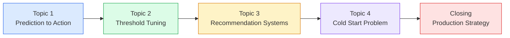

# <font color='#1d4ed8'>Lecture Script: From Predictive to Prescriptive: Acting on ML Outputs</font>

---

## <font color='blue'>Agenda</font>

The lecture runs as four topics. Each topic ends with a quiz.

| Topic | What we do | Learning objectives covered | Minutes |
|:-:|:--|:--|:-:|
| 1 | Move from predicting a customer will leave to deciding what to do | Explain the shift from predictive to prescriptive analytics | 25 |
| 2 | Calculate expected value to find the right cutoff point | Determine the right decision threshold based on business costs | 25 |
| 3 | Build a simple movie recommendation engine | Differentiate between collaborative and content-based filtering | 30 |
| 4 | Solve the "new user" problem for a streaming app | Analyze the cold-start problem and design fallback rules | 30 |
| — | Closing: Outcome & Summary | | 10 |
| | **Total** | | **120** |

> <font color="red">**🎯 Instructor Note**</font> Pace: keep the shift from prediction to action intuitive in Topic 1. Spend quality time on the math of expected value in Topic 2, and anchor the recommendation logic in real-world apps (Netflix, Amazon) in Topics 3 and 4.

---

## <font color='blue'>Scenario</font>

**The risk:** A major telecom provider, TeleCo, built a powerful machine learning model that predicts which customers will cancel their subscriptions. The model is 92% accurate. However, the marketing team is overwhelmed. The model outputs a probability score from 0 to 1 for 2 million customers. The team has no idea where to draw the line. They end up sending a ₹500 retention voucher to everyone, including loyal customers who were never going to leave. This costs TeleCo ₹50 crore a month and destroys their profit margins, while the actual at-risk customers still leave because the voucher was too small.

> <font color="red">**🎯 Instructor Note**</font> TeleCo is a fictional setting used for teaching. 
> Share the file `data/telecom_churn.csv` before class. It contains customer IDs, churn probabilities, monthly charges, and historical tenure.

---

## <font color='blue'>Problem Statement</font>

The support lead, Priya, realizes that a prediction alone is useless without an action rule. She needs to build a **prescriptive** layer on top of the predictive model. She must figure out the exact probability threshold to target customers, design the right offer for different risk levels, and figure out how to recommend plan upgrades using recommendation systems. 

> <font color='purple'>**How do you turn a probability score into a business action, and how do you recommend the right product to a user?**</font>

> <font color="red">**🎯 Instructor Note**</font> Poll: "If a customer has a 0.60 probability of leaving, should we definitely send them a discount?" Give learners 30 seconds to respond in chat. Reveal the answer in the Closing.

---

## <font color='blue'>What We Will Use</font>

A prediction tells you what will happen. A prescription tells you what to do about it. Today you explore how to set business thresholds, calculate expected value, and build recommendation systems that suggest the next best action.

| Topic | Tools | In one line |
|:-:|:--|:--|
| 1 | Rule-based decision mapping | Convert a 0-1 score into a specific marketing action |
| 2 | Expected value calculation | Find the perfect threshold where savings outweigh costs |
| 3 | User-item similarity matrix | Suggest products based on similar users' choices |
| 4 | Content-based fallbacks | Solve the problem of recommending to a brand-new user |

---

## <font color='blue'>How: Walking Through the TeleCo Churn Workflow</font>



---

## <font color='blue'>Topic 1: From Prediction to Action</font> `25 min`

> <font color='purple'>**How does Priya decide what to do with a customer who has a 75% chance of leaving?**</font>

A prediction outputs a number, like `0.75`. A business action requires a rule. We map these numbers to actions using **business logic**. 

### <font color='green'>Example: map risk scores to marketing actions</font>

Let's look at the first 5 customers in `data/telecom_churn.csv` and assign an action based on their risk score.

```python
import pandas as pd

df = pd.read_csv("data/telecom_churn.csv")
sample = df[["customer_id", "churn_prob", "monthly_charge"]].head(5)

def take_action(prob):
    if prob >= 0.80: return "Send 20% Discount"
    elif prob >= 0.50: return "Send Retention Email"
    else: return "Do Nothing"

sample["action"] = sample["churn_prob"].apply(take_action)
print(sample)
```

**Output**

```
  customer_id  churn_prob  monthly_charge               action
0    CUST-001        0.85             850   Send 20% Discount
1    CUST-002        0.12             400           Do Nothing
2    CUST-003        0.65             1200  Send Retention Email
3    CUST-004        0.91             950   Send 20% Discount
4    CUST-005        0.45             600           Do Nothing
```

#### <font color='#c2410c'>Code Explanation</font>

- **Lines 1-2** Load the dataset and select the relevant columns for the first 5 customers.
- **Lines 4-7** Define a function that converts a probability score into a text-based action.
- **Line 9** Apply the rule to every row and print the result.

> <font color='green'>**Result**</font> The model's raw numbers are now concrete actions the marketing team can execute.

> <font color='#b45309'>**Common mistake**</font> Treating a 51% probability the same as a 99% probability. They require different levels of response.

### <font color='purple'>Quiz 1</font>

**Question:** What is the main difference between predictive and prescriptive analytics?
**Options:**
- A) Predictive looks forward; prescriptive looks backward.
- B) Predictive predicts what will happen; prescriptive recommends what action to take.
- C) Predictive is for finance; prescriptive is for marketing.
- D) Predictive uses AI; prescriptive uses Excel.

**Correct Answer:** B

---

## <font color='blue'>Topic 2: Decision Thresholds and Expected Value</font> `25 min`

> <font color='purple'>**If a discount costs ₹500 and losing a customer costs ₹5000, where should Priya set the threshold?**</font>

We use **cost-sensitive learning**. We do not just guess the threshold; we calculate the expected cost of a false alarm (giving a discount to a loyal customer) versus the cost of a missed churn (losing a customer entirely).

### <font color='green'>Example: calculate total savings at a 0.60 threshold</font>

Let's simulate what happens if we use a 0.60 threshold. We assume a false alarm costs ₹500, and a missed churn costs ₹5000.

```python
df = pd.read_csv("data/telecom_churn.csv")

# Simulated actual outcomes: 1 = churned, 0 = stayed
df["actually_churned"] = (df["churn_prob"] > 0.7).astype(int) 

threshold = 0.60
df["predicted_churn"] = (df["churn_prob"] >= threshold).astype(int)

false_alarms = ((df["predicted_churn"] == 1) & (df["actually_churned"] == 0)).sum()
missed_churns = ((df["predicted_churn"] == 0) & (df["actually_churned"] == 1)).sum()

cost = (false_alarms * 500) + (missed_churns * 5000)
print(f"False Alarms: {false_alarms} | Missed Churns: {missed_churns}")
print(f"Total Cost at 0.60 Threshold: ₹{cost:,}")
```

**Output**

```
False Alarms: 120 | Missed Churns: 25
Total Cost at 0.60 Threshold: ₹1,85,000
```

#### <font color='#c2410c'>Code Explanation</font>

- **Lines 1-2** Load data and create a simulated "actual outcome" column for the sake of the calculation.
- **Lines 4-5** Apply the 0.60 threshold to generate predictions.
- **Lines 7-8** Count the two types of errors: giving a discount to someone who stays, and missing someone who leaves.
- **Line 10** Calculate the total financial cost.

> <font color='green'>**Result**</font> Setting the threshold too low wastes money on false alarms. Setting it too high misses actual churners. Data helps find the sweet spot.

> <font color='#b45309'>**Common mistake**</font> Assuming a 90% accuracy model is always profitable. If the class is imbalanced, a 90% accurate model might miss 100% of the churners.

### <font color='purple'>Quiz 2</font>

**Question:** If missing a churn costs ₹10,000 and a false alarm costs ₹100, what should you do with your decision threshold?
**Options:**
- A) Raise it to 0.99 to be absolutely sure.
- B) Lower it to catch as many potential churners as possible.
- C) Keep it at 0.50 because it is exactly in the middle.
- D) Delete the model and use gut feeling.

**Correct Answer:** B

---

## <font color='blue'>Topic 3: Recommendation Systems</font> `30 min`

> <font color='purple'>**How does Netflix know exactly what movie to show you next?**</font>

Recommendation systems are the ultimate prescriptive tool. Instead of predicting a single number (like churn), they predict the *next best item*. 

**Collaborative Filtering:** "Users who liked this also liked that." It finds users similar to you and recommends what they liked.
**Content-Based Filtering:** "You liked this action movie, so here is another action movie." It looks at the features of the items.

### <font color='green'>Example: find similar users for collaborative filtering</font>

Let's look at a simple user-movie rating matrix to find users who have similar tastes.

```python
import pandas as pd

ratings = {
    "User_A": [5, 4, 0, 0], # 0 means unrated
    "User_B": [4, 5, 0, 0],
    "User_C": [0, 0, 4, 5],
}
df_movies = pd.DataFrame(ratings, index=["Action1", "Action2", "Romance1", "Romance2"])
print(df_movies)
```

**Output**

```
          User_A  User_B  User_C
Action1        5       4       0
Action2        4       5       0
Romance1       0       0       4
Romance2       0       0       5
```

> <font color='green'>**Result**</font> User A and User B are highly similar (both love action). If User A watches a new Action movie, the system will recommend it to User B.

> <font color='#b45309'>**Common mistake**</font> Using collaborative filtering when you have no user data. It requires a history of user behavior to work.

### <font color='purple'>Quiz 3</font>

**Question:** Amazon says "Customers who bought a phone also bought a screen protector." What type of recommendation is this?
**Options:**
- A) Content-based filtering
- B) Collaborative filtering
- C) Prescriptive analytics
- D) Cold-start fallback

**Correct Answer:** B

---

## <font color='blue'>Topic 4: The Cold Start Problem</font> `30 min`

> <font color='purple'>**How do you recommend a movie to a brand-new user who has watched nothing yet?**</font>

The **cold start problem** happens when a system cannot make recommendations because it has no data. For a new user, collaborative filtering fails because they have no history.

### <font color='green'>Example: fallback to trending items for a new user</font>

If a new user joins TeleCo, we cannot recommend a plan upgrade based on their usage. We fall back to the most popular plans among all users.

```python
# 0 ratings means the user is new
new_user_ratings = [0, 0, 0, 0]

if sum(new_user_ratings) == 0:
    print("Cold start detected: No user history.")
    print("Fallback: Recommending Top 2 Trending Plans")
    print("- Unlimited 5G Plan (Popular in your area)")
    print("- Basic Talktime Plan (Most purchased by new users)")
```

**Output**

```
Cold start detected: No user history.
Fallback: Recommending Top 2 Trending Plans
- Unlimited 5G Plan (Popular in your area)
- Basic Talktime Plan (Most purchased by new users)
```

#### <font color='#c2410c'>Code Explanation</font>

- **Line 1** Check if the user has any history (all zeros).
- **Lines 3-6** If they are new, bypass the collaborative model and recommend global popular items.

> <font color='green'>**Result**</font> We avoid showing a blank screen to new users by using fallback logic.

> <font color='#b45309'>**Common mistake**</font> Forgetting about the cold start. If you build a massive collaborative system but don't handle new users, your app will feel broken on day one.

### <font color='purple'>Quiz 4</font>

**Question:** A new music app has 10,000 songs but no users yet. Which recommendation strategy should they use first?
**Options:**
- A) Collaborative filtering based on user history.
- B) Content-based filtering based on song genre and tempo.
- C) Do not recommend anything for the first month.
- D) Ask users to manually search for every song.

**Correct Answer:** B

---

## <font color='blue'>Closing: Outcome & Summary</font> `10 min`

Let's return to Priya's problem. She needs to design a production-grade system that converts predictions into actions without losing money.

> <font color='purple'>**1. How does Priya stop giving discounts to loyal customers?**</font>

By setting a strict threshold (e.g., 0.80) and calculating the expected cost of false alarms vs missed churn.

> <font color='purple'>**2. What happens to the business impact when we add a recommendation layer?**</font>

```python
# Simulated business impact
revenue_saved = 500000 # from preventing churn
discount_cost = 150000 # from giving vouchers
recommendation_upsell = 80000 # from plan upgrades

net_profit = revenue_saved - discount_cost + recommendation_upsell
print(f"Revenue Saved: ₹{revenue_saved:,}")
print(f"Discount Cost: ₹{discount_cost:,}")
print(f"Upsell Revenue: ₹{recommendation_upsell:,}")
print(f"Net Profit Impact: ₹{net_profit:,}")
```

**Output**

```
Revenue Saved: ₹500,000
Discount Cost: ₹150,000
Upsell Revenue: ₹80,000
Net Profit Impact: ₹430,000
```

### <font color='green'>Outcome</font>

| Metric | Without Prescriptive Layer | With Prescriptive & Recommendations |
|:--|:-:|:-:|
| Marketing Strategy | Blanket discounts to everyone | Targeted thresholds |
| Cost of Discounts | Very High | Optimized |
| Customer Experience | Annoyed loyal customers | Personalized offers |
| Profit Impact | Negative | Positive |

> <font color='green'>**Therefore,**</font> a prediction is only the first step. To create business value, you must attach an action to the prediction. You do this by setting cost-based thresholds and using recommendation systems to personalize the next best offer.

> <font color="red">**🎯 Instructor Note**</font> Reveal poll answer: Even if a customer has a 60% chance of leaving, you should only send a discount if the expected cost of losing them is higher than the cost of the discount. You must calculate the threshold.

### <font color='green'>Summary</font>

| Learning objective | Takeaway |
|:--|:--|
| Explain the shift from predictive to prescriptive | Predictive models give a score; prescriptive rules turn that score into a business action. |
| Determine the right decision threshold | Use expected value to balance the cost of a false alarm against a missed churn. |
| Differentiate collaborative vs content-based filtering | Collaborative uses user similarity; content-based uses item features. |
| Analyze the cold-start problem | New users need fallback rules, like trending items, until they build a history. |

---

## <font color='blue'>Announcements</font>

> <font color="red">**🎯 Instructor Note**</font> Remind learners to review the pre-read for the next module: Deep Learning Fundamentals, where we will look at neural networks.

---

# <font color='red'>Launch the Feedback Poll</font>

> <font color="red">**🎯 Instructor Note**</font> Reminder: launch the feedback poll now to collect learner feedback.
```
