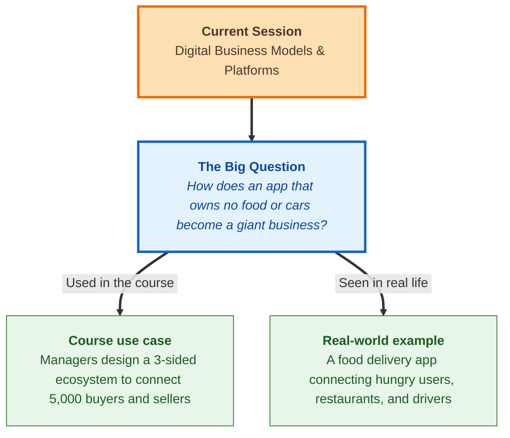

## <span style="color:#2F7DDE">Digital Business Models & Platforms</span>

### <span style="color:#2F7DDE">Mental Map</span>



---

### <span style="color:#2F7DDE">What You'll Learn</span>

Have you ever wondered how a food delivery app makes money without cooking any food?

By the end of this session, you will be able to:

- <span style="color:#D9660B">**Identify**</span> the core difference between a traditional business and a digital platform.
- <span style="color:#D9660B">**Explain**</span> how network effects make an app more valuable to you.
- <span style="color:#D9660B">**Differentiate**</span> between a company's business model and its wider ecosystem.
- <span style="color:#D9660B">**Design**</span> a simple strategy to attract two separate user groups to a new app.

> <span style="color:#2F7DDE">**Topics you will meet:**</span> digital business models, digital platforms, ecosystems, network effects.
>
> Join the session to learn each of these in detail.

---

### <span style="color:#2F7DDE">Why You Are Learning This Topic</span>

You open a food app to order dinner. You see restaurants, delivery drivers, and reviews. The app owns no kitchens or cars. A <span style="color:#D9660B">**digital platform**</span> means a system that creates value by connecting separate groups. In this course, you will learn how to structure these connections to grow a business.

> <span style="color:#2F7DDE">**Think about it:**</span> What makes you choose one delivery app over another?

---

### <span style="color:#2F7DDE">The Food Delivery Puzzle</span>

Here are three apps and the groups they connect.

| App Name | Group 1 | Group 2 | What is exchanged |
|:--------:|:-------:|:-------:|:-----------------:|
| QuickBite | Restaurants | Hungry Users | Food delivery |
| RideNow | Drivers | Passengers | Car rides |
| ShopEasy | Sellers | Buyers | Goods |

<span style="color:#D9660B">**What you want to happen:**</span>

- Know why these apps need both groups to succeed.
- See what happens when more drivers join RideNow.
- Know how to get the first 100 users to join QuickBite.

> <span style="color:#D9660B">**Wonder about this:**</span>
>
> - Why do platforms struggle to get their first users?
> - Who brings the most value to the app?

---

### <span style="color:#2F7DDE">Think It Through</span>

There is no wrong first try. Keep your guesses for the session.

**1. Who does a brand new delivery app need first: restaurants or eaters?**
Hint: Think about which group brings the supply.

**2. What happens to waiting times when more drivers join the app?**
Hint: Look at the supply of cars.

**3. How is a traditional taxi company different from a ride-sharing app?**
Hint: Think about who owns the cars.

---

### <span style="color:#2F7DDE">One Question to Carry Into the Session</span>

> <span style="color:#2F7DDE">**How do you solve the chicken-and-egg problem of a new platform?**</span>
>
> And how do network effects protect a platform from competitors?
```
