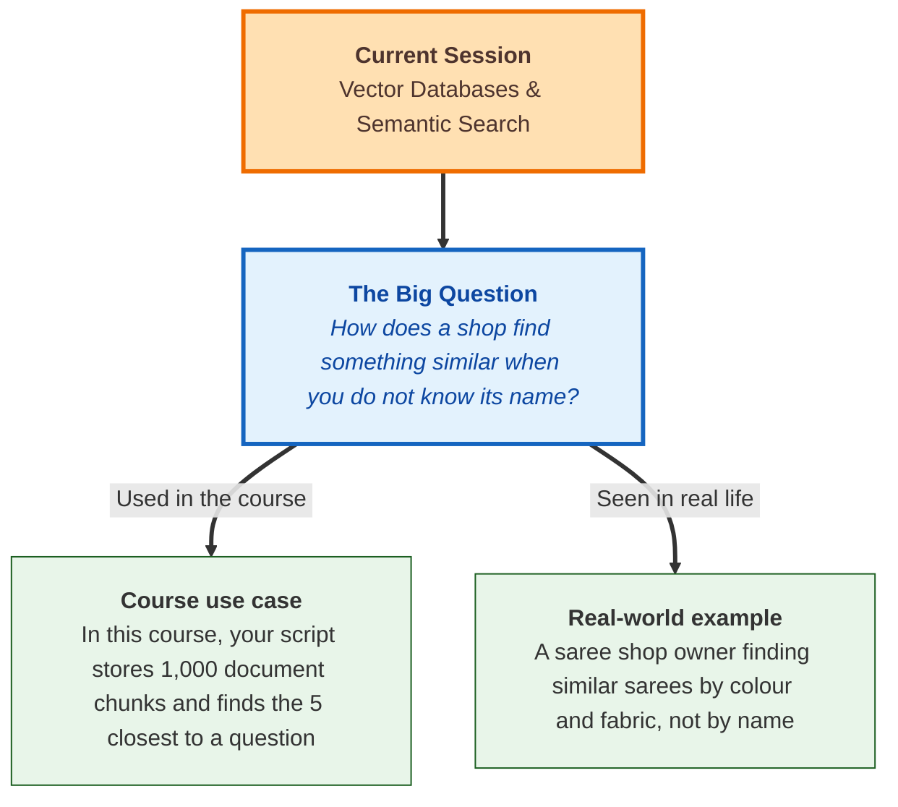

## <span style="color:#2F7DDE">Vector Databases & Semantic Search</span>

### <span style="color:#2F7DDE">Mental Map</span>



---

### <span style="color:#2F7DDE">What You'll Learn</span>

Have you ever wondered how a shopkeeper finds a saree that looks like yours, without knowing its name?

By the end of this session, you will be able to:

- <span style="color:#D9660B">**Identify**</span> the one detail you store with each saree, like its colour code.
- <span style="color:#D9660B">**Explain**</span> why a similarity search finds "close" and not "exact match".
- <span style="color:#D9660B">**Apply**</span> a lookup rule to 5 sarees when one is brought to the counter.
- <span style="color:#D9660B">**Compare**</span> a small shop shelf with a big warehouse shelf holding 2,000 sarees.
- <span style="color:#D9660B">**Judge**</span> which of 3 found sarees is closest to the one on the counter.

> <span style="color:#2F7DDE">**Topics you will meet:**</span> Introduction to vector databases, indexing data, querying for similarity, and Chroma vs FAISS.
>
> Join the session to learn each of these in detail.

---

### <span style="color:#2F7DDE">Why You Are Learning This Topic</span>

A customer walks into a saree shop holding one saree. She says she wants "something like this, but lighter".

The shopkeeper cannot search by name. The saree has no label.

He has 2,000 sarees on shelves behind him. He has seen them many times. He knows which ones look close.

A <span style="color:#D9660B">**similarity search**</span> means finding items that sit close to yours in some measure.

In this course, you will use the same idea to find the 5 closest document chunks to a question.

> <span style="color:#2F7DDE">**Think about it:**</span> How would you sort 2,000 sarees so the closest ones are easy to find?

---

### <span style="color:#2F7DDE">The Saree Shop Puzzle</span>

Here are 5 sarees on the top shelf.

| Saree | Colour | Fabric |
|:-----:|:-------|:-------|
| S1 | Deep maroon | Silk |
| S2 | Light pink | Silk |
| S3 | Deep maroon | Cotton |
| S4 | Light pink | Cotton |
| S5 | Dark green | Silk |

<span style="color:#D9660B">**What you want to happen:**</span>

- Find the 2 sarees closest to a deep maroon silk saree on the counter.
- Skip the green one without scanning every shelf.
- Pull the 2 closest in under a second, even from 2,000 sarees.

Here is how it might start. You do not need to understand it yet.

```python
shop.add(ids=saree_ids, embeddings=vectors, metadatas=tags)
hits = shop.query(vector, top_k=2)
```

> <span style="color:#D9660B">**Wonder about this:**</span>
>
> - Should "light pink" count as similar to "deep maroon"?
> - Would checking every saree by eye work at 2,000 pieces?

---

### <span style="color:#2F7DDE">Think It Through</span>

There is no wrong first try. Keep your guesses for the session.

**1. Which saree on the top shelf is the closest match to the one on the counter?**
Hint: Match both colour and fabric, not just one.

**2. If the shop had 20,000 sarees, why would checking each one be too slow?**
Hint: Think about how long a full shelf check takes.

**3. Which two sarees would you show the customer, and in what order?**
Hint: Closest first, second closest next.

---

### <span style="color:#2F7DDE">One Question to Carry Into the Session</span>

> <span style="color:#2F7DDE">**How can a computer store 2,000 items so it finds the closest ones in a blink?**</span>
>
> And how can you check that the 2 it returns really are the closest?
