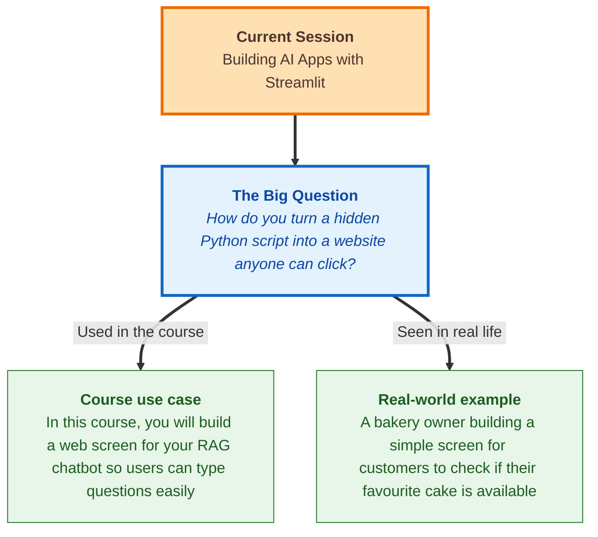

## <span style="color:#2F7DDE">Building AI Apps with Streamlit</span>

### <span style="color:#2F7DDE">Mental Map</span>



---

### <span style="color:#2F7DDE">What You'll Learn</span>

Have you ever wondered how a simple Python script becomes a clickable web page?

By the end of this session, you will be able to:

- <span style="color:#D9660B">**Identify**</span> the basic blocks of a web app, like titles and text boxes.
- <span style="color:#D9660B">**Explain**</span> how a button on a screen tells the computer to start a task.
- <span style="color:#D9660B">**Apply**</span> text inputs and buttons to a bakery menu check.
- <span style="color:#D9660B">**Build**</span> a working web screen that displays text back to the user.

> <span style="color:#2F7DDE">**Topics you will meet:**</span> Streamlit basics, creating buttons and inputs, displaying outputs, and deploying a demo.
>
> Join the session to learn each of these in detail.

---

### <span style="color:#2F7DDE">Why You Are Learning This Topic</span>

You have written great Python code in your notebook. It answers questions and searches data.

But your family or friends cannot use it. They do not know how to open a notebook and click "Run".

A <span style="color:#D9660B">**web app**</span> means a simple website that people can click and use.

In this course, you will use the same tool to put a friendly face on your AI projects.

> <span style="color:#2F7DDE">**Think about it:**</span> How can you make your code usable for someone who does not know Python?

---

### <span style="color:#2F7DDE">The Bakery App Puzzle</span>

A baker wants a small screen in the shop. Customers can check if a cake is ready.

| Cake | Price | Status |
|:-----|:------|:-------|
| Chocolate | 500 | Ready |
| Red Velvet | 700 | Sold Out |
| Vanilla | 450 | Ready |

<span style="color:#D9660B">**What you want to happen:**</span>

- A customer types "Chocolate" in a text box.
- They click a button that says "Check".
- The screen shows a green "Ready" message.

Here is how it might start. You do not need to understand it yet.

```python
import streamlit as st
cake = st.text_input("Enter cake name:")
st.button("Check")
```

> <span style="color:#D9660B">**Wonder about this:**</span>
>
> - What happens if the customer clicks the button without typing?
> - How does the screen know to show a green message instead of a red one?

---

### <span style="color:#2F7DDE">Think It Through</span>

There is no wrong first try. Keep your guesses for the session.

**1. If the customer types "chocolate" in lowercase, will the app find it?**
Hint: Think about how computers read text.

**2. What should the screen show if the bakery has no cakes left at all?**
Hint: Look at the table to see what happens when a cake is sold out.

**3. How is typing in a text box different from writing code?**
Hint: Think about who is using the app.

---

### <span style="color:#2F7DDE">One Question to Carry Into the Session</span>

> <span style="color:#2F7DDE">**How does a Python script read a click on a web page?**</span>
>
> And how does it show the answer on the screen instantly?
