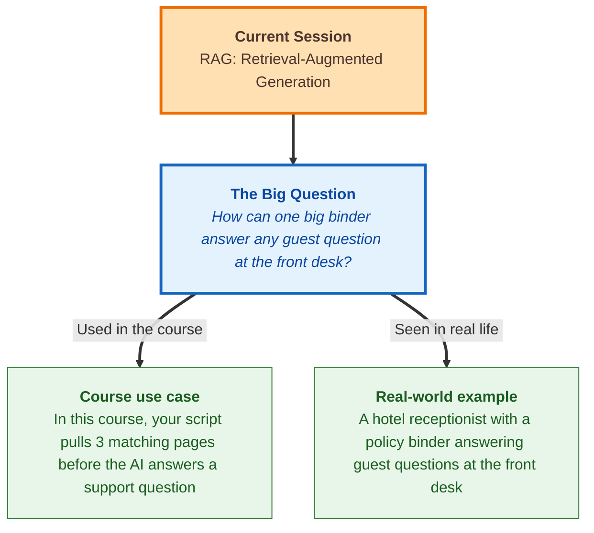

## <span style="color:#2F7DDE">RAG: Retrieval-Augmented Generation</span>

### <span style="color:#2F7DDE">Mental Map</span>



---

### <span style="color:#2F7DDE">What You'll Learn</span>

Have you ever wondered how a receptionist answers any guest question from one heavy binder?

By the end of this session, you will be able to:

- <span style="color:#D9660B">**Identify**</span> the right page in the binder for one guest question.
- <span style="color:#D9660B">**Explain**</span> why an answer with a page behind it is safer than one from memory.
- <span style="color:#D9660B">**Apply**</span> a two-step rule to 5 guest questions in a row.
- <span style="color:#D9660B">**Compare**</span> an answer with a page to one with no page at all.
- <span style="color:#D9660B">**Judge**</span> when the binder has no page and the answer must be skipped.

> <span style="color:#2F7DDE">**Topics you will meet:**</span> The RAG workflow, combining retrieval with generation, reducing hallucinations, and context windows.
>
> Join the session to learn each of these in detail.

---

### <span style="color:#2F7DDE">Why You Are Learning This Topic</span>

You walk up to a hotel front desk and ask about bringing your dog. The receptionist turns to a heavy binder and finds the pet page. She reads the rule and answers you in her own words.

Behind her sits a second receptionist. She answers from memory and gets three questions wrong in one day. Guests then complain at the manager's desk.

A <span style="color:#D9660B">**retrieval**</span> means finding the right page before answering.

In this course, you will use the same two-step rule to answer questions from your own documents.

> <span style="color:#2F7DDE">**Think about it:**</span> What should the second receptionist do when she is not sure?

---

### <span style="color:#2F7DDE">The Front Desk Puzzle</span>

Here are 5 guest questions from one morning shift.

| Note | Guest question |
|:----:|:---------------|
| 1 | Can I bring my dog to the room? |
| 2 | What time does breakfast start? |
| 3 | Is parking free for guests? |
| 4 | Can my dog sit in the lobby? |
| 5 | Do you rent bicycles at the desk? |

<span style="color:#D9660B">**What you want to happen:**</span>

- Pull the right page for each question.
- Answer only from the text on that page.
- Skip a question when the binder has no page for it.

Here is how it might start. You do not need to understand it yet.

```python
pages = search(binder, question, top_k=3)
answer = llm(question, context=pages)
```

> <span style="color:#D9660B">**Wonder about this:**</span>
>
> - What should the receptionist say when note 5 has no matching page?
> - Would 10 pulled pages help her more than 3?

---

### <span style="color:#2F7DDE">Think It Through</span>

There is no wrong first try. Keep your guesses for the session.

**1. Which two notes both need the pet policy page?**
Hint: Read notes 1 and 4 again.

**2. What should the receptionist say for note 5 if no bicycle page exists?**
Hint: Think about a safe reply when the page is missing.

**3. If she pulls 10 pages for one question, what could go wrong?**
Hint: Think about reading too much at once.

---

### <span style="color:#2F7DDE">One Question to Carry Into the Session</span>

> <span style="color:#2F7DDE">**How does a script find the right 3 pages before the AI answers?**</span>
>
> And how can you check that the answer really came from those pages?
