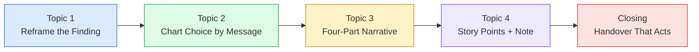

# <font color='#1d4ed8'>Lecture Script: Insight Communication & Storytelling with Tableau</font>

---

## <font color='blue'>Agenda</font>

The lecture runs as four topics. Each topic ends with a quiz.

| Topic | What we do | Learning objectives covered | Minutes |
|:-:|:--|:--|:-:|
| 1 | Turn a returns table into a decision-shaped finding for a specific reader | Reframe a finding around a decision the audience is about to make | 28 |
| 2 | Match a chart to the message it must carry, not the chart gallery | Justify a chart choice by the message it carries rather than preference | 26 |
| 3 | Order the four parts of a dashboard narrative so the reader reaches the recommendation convinced | Take a viewer from headline to recommendation in a deliberate order | 30 |
| 4 | Build Story Points, annotations and a one-page Notion note with owner and date | Leave behind a written record someone can act on without the analyst | 26 |
| — | Closing: Outcome & Summary | | 10 |
| | **Total** | | **120** |

> <font color="red">**🎯 Instructor Note**</font> Pace: Topic 1 is the conceptual heart of the session — spend quality time on the difference between a finding and a decision. Topic 3 is where students usually coast; make them write all four parts before opening Tableau. Topic 4 connects directly to real handover behaviour — let learners inspect the exact Notion note at the end of the 120-row `data/phone_returns.csv` file used throughout.

---

## <font color='blue'>Scenario</font>

**The risk:** A retail chain sells five phone models across 42 stores. Last month, the area manager asked for the returns data. The analyst sent a sorted bar chart titled "Returns by Model" with no next step. The manager opened it, said "okay, I can see the numbers", closed the tab, and did nothing. Returns kept climbing for another quarter. By the time a second review happened, the shop had paid ₹1.58 lakh in repair costs — and 61% of that came from a single model that nobody flagged.

> <font color="red">**🎯 Instructor Note**</font> The chain and store counts are illustrative. Do not claim a real retailer's data. The 5-row `phone_returns.csv` file is invented for teaching and is small enough that every number can be checked by hand. Share the file before class.

---

## <font color='blue'>Problem Statement</font>

Store manager Priya received a returns report from the analyst with a chart titled "Returns by Model" and no recommendation. She could see that a model called Orbit 5 had high returns, but she could not tell whether to pull it from the shelf this week, wait for the next review, or escalate to the brand. She opened the report on her phone between customer visits, read the chart in six seconds, and closed it. The returns continued for another quarter. When the finance lead finally asked "why did nobody flag Orbit 5?", the answer was simple: the chart was correct, but it was never attached to a decision.

> <font color='purple'>**How do you turn a correct chart into a decision a manager will act on before the day ends, and how do you leave a record that survives after you close your laptop?**</font>

> <font color="red">**🎯 Instructor Note**</font> Poll: "If a chart shows a problem but no recommendation, who is responsible — the analyst or the reader?" Give learners 30 seconds to respond in chat. Reveal the answer in the Closing.

---

## <font color='blue'>What We Will Use</font>

A chart is the evidence. A story is the argument. An **insight** is a finding attached to a decision someone is about to make, in the order headline, context, insight, recommendation — the same order a reader's eye and attention actually move. Today you explore how to reframe a finding around a decision, how to choose the chart that carries the message fastest, how to build the four-part narrative inside Tableau, and how to write a one-page handover note a manager can act on without you.

| Topic | Tools | In one line |
|:-:|:--|:--|
| 1 | Decision frame, reframed finding | Attach a number to the decision the reader is about to make |
| 2 | Chart selection by message class | Match the shape of the chart to the shape of the message |
| 3 | Four-part narrative, Tableau layout | Take the reader from headline to recommendation in a deliberate order |
| 4 | Story Points, annotations, Notion note | Leave a one-page record with an owner and a revisit date |

---

## <font color='blue'>How: Walking Through the Returns Story Workflow</font>



---

## <font color='blue'>Topic 1: Reframing the Finding Around a Decision</font> `28 min`

> <font color='purple'>**Why does a correct chart still fail when it reaches a manager?**</font>

A finding is a number attached to nothing. A decision is a choice someone is about to make. **Reframing** means attaching the number to the choice, so the reader sees why it matters before they see how big it is. Without the reframe, the reader does all the interpreting work — and in a real review, they usually do not bother.

### <font color='green'>Example: compare raw counts with return rates</font>

> <font color='purple'>**Which model does the raw count point to, and which model does the return rate point to?**</font>

Let us load the returns file and compute both a raw count and a return rate for each model.

**Predict before running: What will happen?**

> <font color="red">**🎯 Instructor Note**</font> Expected: the raw count points to Nova X because it sold the most, but the return rate points to Orbit 5 because it returns 40% of what it sells.

```python
import pandas as pd
df = pd.read_csv("data/phone_returns.csv")
df["return_rate"] = df["units_returned"] / df["units_sold"]
df["repair_cost"] = df["units_returned"] * df["avg_repair_cost_inr"]
by_count = df.sort_values("units_returned", ascending=False)[["model", "units_returned", "return_rate"]]
print(by_count.to_string(index=False))
```

**Output**

```
   model  units_returned  return_rate
  Nova X              40     0.133333
 Orbit 5              32     0.400000
Pulse 3               4     0.066667
  Mini 7              3     0.060000
  Edge 9              2     0.050000
```

#### <font color='#c2410c'>Code Explanation</font>

- **Lines 1-2** Load the 5-row returns file and compute two derived columns: return rate per model and total repair cost.
- **Line 3** Sort by raw returned units so the biggest count appears first.
- **Line 4** Print the model, raw count, and rate side by side.

> <font color='green'>**Result**</font> Nova X leads on raw count with 40 returns — but its return rate is 13%. Orbit 5 is second on count but leads on rate at 40%: two out of every five sold come back.

### <font color='green'>Extending it: reframe the same finding for two different audiences</font>

> <font color='purple'>**What does Priya the shop manager need to hear, and what does the finance lead need to hear from the same number?**</font>

> <font color="red">**🎯 Instructor Note**</font> Ask learners: which audience cares about return rate and which cares about repair cost in rupees? Give learners 30 seconds to respond in chat. Expected: shop manager cares about rate (should I pull it?), finance cares about rupees (how much did it cost?).

```python
orbit = df[df["model"] == "Orbit 5"].iloc[0]
total_cost = df["repair_cost"].sum()
share = orbit["repair_cost"] / total_cost

print(f"For shop manager: Orbit 5 returns are {orbit['return_rate']:.0%} of sales.")
print(f"For finance lead: Orbit 5 repair cost is ₹{orbit['repair_cost']:,.0f} — {share:.0%} of total.")
```

**Output**

```
For shop manager: Orbit 5 returns are 40% of sales.
For finance lead: Orbit 5 repair cost is ₹96,000 — 61% of total.
```

> <font color='green'>**Result**</font> Same finding, two reframes. The shop manager decides whether to pull the model; the finance lead decides whether to escalate the cost.

> <font color='#b45309'>**Common mistake**</font> Reporting the raw count and calling it the finding. Raw counts favour high-volume products. Return rate and repair cost together tell the decision-shaped story.

### <font color='purple'>Quiz 1</font>

**Question:** A store manager reads a report that says "Orbit 5 had 32 returns last month." What is missing from this finding?

**Options:**
- A) A bigger number so the reader understands the scale.
- B) A decision the finding points to and the consequence attached to it.
- C) A second chart showing Nova X so the reader can compare.
- D) A list of every customer who returned the model.

**Correct Answer:** B

**Explanation:**
- **A)** Wrong because a bigger number is still just a number — the reader does not know what to do with it.
- **B)** Correct because a finding becomes an insight only when the reader sees the consequence and the decision it points to.
- **C)** Wrong because more charts add more evidence without adding a decision.
- **D)** Wrong because a customer list adds detail without adding meaning.

---

## <font color='blue'>Topic 2: Chart Choice by Message</font> `26 min`

> <font color='purple'>**Why does the same data hide a problem in one chart and scream it in another?**</font>

A chart type carries an implicit promise. A pie chart promises "these slices are parts of one whole." A sorted bar chart promises "these are ranked and one stands out." A line chart promises "there is a real scale connecting these points." **Chart choice** means picking the chart whose promise matches the message you want to land, not the chart that looks best in the gallery.

### <font color='green'>Example: sorted vs unsorted bar chart on the same data</font>

> <font color='purple'>**If you keep the bars in table order, will Orbit 5 stand out at a glance?**</font>

Let us look at the same data twice — once in table order, once sorted by return rate.

**Predict before running: What will happen?**

> <font color="red">**🎯 Instructor Note**</font> Expected: Orbit 5 is buried in the middle in table order and towers at the top when sorted. Same numbers, very different reader experience.

```python
import pandas as pd
df = pd.read_csv("data/phone_returns.csv")
df["return_rate"] = df["units_returned"] / df["units_sold"]
print("Table order:", list(df["model"]))
print("Rate order :", list(df.sort_values("return_rate", ascending=False)["model"]))
```

**Output**

```
Table order: ['Nova X', 'Orbit 5', 'Pulse 3', 'Edge 9', 'Mini 7']
Rate order : ['Orbit 5', 'Nova X', 'Pulse 3', 'Mini 7', 'Edge 9']
```

#### <font color='#c2410c'>Code Explanation</font>

- **Lines 1-2** Load the returns file and compute return rate per model.
- **Line 3** Show the order as it sits in the file — the natural default when someone builds a chart without thinking.
- **Line 4** Show the order by return rate, sorted descending.

> <font color='green'>**Result**</font> In table order, Orbit 5 sits second and blends in. In rate order, Orbit 5 is first and impossible to miss. The chart reader does not have to search.

### <font color='green'>Extending it: match the message to the chart class</font>

> <font color='purple'>**For each of three messages, which chart class carries it fastest?**</font>

> <font color="red">**🎯 Instructor Note**</font> Ask learners: what is the message "returns rose after the March launch" — a comparison, a trend, or a distribution? Give learners 30 seconds to respond in chat. Expected: a trend, so a line chart with a marker at March.

```python
messages = {
    "One model towers above the rest":     "sorted bar (descending)",
    "Returns rose after the March launch": "line with a marker at March",
    "Returns are spread across models":    "bar (unsorted) or histogram",
}
for msg, chart in messages.items():
    print(f"{msg}  ->  {chart}")
```

**Output**

```
One model towers above the rest  ->  sorted bar (descending)
Returns rose after the March launch  ->  line with a marker at March
Returns are spread across models  ->  bar (unsorted) or histogram
```

> <font color='green'>**Result**</font> Each message has a chart class that carries it without explanation. Anything else asks the reader to decode the encoding.

> <font color='#b45309'>**Common mistake**</font> Choosing a pie chart because it looks polished. A pie chart of five categories makes the biggest slice and the second-biggest slice look almost equal. A sorted bar makes the gap obvious in two seconds.

### <font color='purple'>Quiz 2</font>

**Question:** The message you want the reader to remember is "Orbit 5 towers above the others." Which chart carries that message fastest?

**Options:**
- A) A pie chart with five slices, all labelled.
- B) An unsorted bar chart in table order.
- C) A sorted bar chart, descending, with Orbit 5 at the top.
- D) A scatter of units sold against units returned, unlabelled.

**Correct Answer:** C

**Explanation:**
- **A)** Wrong because a pie hides small gaps and dilutes the tower effect.
- **B)** Wrong because Orbit 5 sits in the middle and blends into the row.
- **C)** Correct because a descending sorted bar makes the tallest bar impossible to miss.
- **D)** Wrong because a scatter shows relationship, not ranking — the tower message is lost.

---

## <font color='blue'>Topic 3: The Four-Part Story Order</font> `30 min`

> <font color='purple'>**Why does the order of the four sentences matter more than the sentences themselves?**</font>

Putting the insight first forces the reader to guess why it matters. Putting the recommendation first forces the reader to trust you without evidence. **The four-part order** — headline, context, insight, recommendation — is the order a reader's attention is already asking for. Each part answers a question the reader is about to ask.

### <font color='green'>Example: write the four parts from the returns data</font>

> <font color='purple'>**What are the four sentences, in order, that take Priya from "returns are high" to "pull the model this week"?**</font>

Let us build the four parts programmatically so the reader can check every number.

**Predict before running: What will happen?**

> <font color="red">**🎯 Instructor Note**</font> Expected: the four lines are each one sentence, the context line quantifies the shop average, and the recommendation names an owner and a date — without which it is only a suggestion.

```python
import pandas as pd
df = pd.read_csv("data/phone_returns.csv")
df["return_rate"] = df["units_returned"] / df["units_sold"]
df["repair_cost"] = df["units_returned"] * df["avg_repair_cost_inr"]

orbit = df[df["model"] == "Orbit 5"].iloc[0]
shop_rate = df["units_returned"].sum() / df["units_sold"].sum()
cost_share = orbit["repair_cost"] / df["repair_cost"].sum()

print(f"Headline:       Orbit 5 was returned {orbit['units_returned']} times last month.")
print(f"Context:        The shop-wide return rate is {shop_rate:.1%}.")
print(f"Insight:        Orbit 5 accounts for {cost_share:.0%} of repair cost, at a {orbit['return_rate']:.0%} return rate.")
print("Recommendation: Pull Orbit 5 for two weeks. Owner: shop manager. Review: 30 November.")
```

**Output**

```
Headline:       Orbit 5 was returned 32 times last month.
Context:        The shop-wide return rate is 13.4%.
Insight:        Orbit 5 accounts for 61% of repair cost, at a 40% return rate.
Recommendation: Pull Orbit 5 for two weeks. Owner: shop manager. Review: 30 November.
```

#### <font color='#c2410c'>Code Explanation</font>

- **Lines 1-3** Load the file and compute return rate and repair cost per model.
- **Lines 5-7** Isolate Orbit 5's row and compute the shop-wide return rate and Orbit 5's share of total repair cost.
- **Lines 9-12** Print the four parts in order, each one sentence long.

> <font color='green'>**Result**</font> Four sentences, four questions answered. The headline says what happened. The context says against what baseline. The insight says why it matters. The recommendation says who does what by when.

### <font color='green'>Extending it: check that each part stands on its own</font>

> <font color='purple'>**If the reader only reads the headline and the recommendation, does the message still land?**</font>

> <font color="red">**🎯 Instructor Note**</font> Ask learners: which two sentences would a busy manager read first? Give learners 30 seconds to respond in chat. Expected: headline and recommendation. If those two lines do not make sense without the other two, the story is not finished.

```python
parts = {
    "Headline":       "Orbit 5 was returned 32 times last month.",
    "Context":        "The shop-wide return rate is 13.4%.",
    "Insight":        "Orbit 5 accounts for 61% of repair cost, at a 40% return rate.",
    "Recommendation": "Pull Orbit 5 for two weeks. Owner: shop manager. Review: 30 November.",
}
print("Top-and-bottom check:")
print("  " + parts["Headline"])
print("  " + parts["Recommendation"])
print("  Does it work alone?  Yes, because the recommendation names an action and a date.")
```

**Output**

```
Top-and-bottom check:
  Orbit 5 was returned 32 times last month.
  Pull Orbit 5 for two weeks. Owner: shop manager. Review: 30 November.
  Does it work alone?  Yes, because the recommendation names an action and a date.
```

> <font color='green'>**Result**</font> A manager skimming top and bottom still knows what happened and what to do. The middle two sentences are the proof, not the only content.

> <font color='#b45309'>**Common mistake**</font> Ending on the insight. An insight without a recommendation is a finding — it leaves the decision to the reader, which is exactly the failure that started this session.

### <font color='purple'>Quiz 3</font>

**Question:** A dashboard narrative contains: "Orbit 5 is 61% of cost", "The shop-wide rate is 13.4%", "Orbit 5 was returned 32 times", "Pull it for two weeks, owner shop manager, review 30 Nov." What is the correct order?

**Options:**
- A) Insight, context, headline, recommendation.
- B) Headline, context, insight, recommendation.
- C) Recommendation, insight, context, headline.
- D) Context, headline, recommendation, insight.

**Correct Answer:** B

**Explanation:**
- **A)** Wrong because putting the insight first forces the reader to guess the baseline.
- **B)** Correct because it is the order the reader's attention is already asking for.
- **C)** Wrong because the recommendation lands before the reader has seen any evidence.
- **D)** Wrong because the context only matters once the headline has set up what is being measured.

---

## <font color='blue'>Topic 4: Story Points, Annotations and a Written Handover</font> `26 min`

> <font color='purple'>**What survives after you close your laptop — the dashboard, or the note that goes with it?**</font>

A dashboard lives in Tableau. A written note lives in inboxes, Slack messages and meeting notes — and those are where decisions actually get made. **A written handover** is the one-page note that carries the same four parts, plus a screenshot or link to the dashboard, plus an owner and a revisit date. Without the owner and the date, the recommendation is a wish.

### <font color='green'>Example: generate the one-page Notion note from the data</font>

> <font color='purple'>**What does a note under 150 words look like that a manager can act on without you in the room?**</font>

Let us build the full note as a single string so its length can be checked.

**Predict before running: What will happen?**

> <font color="red">**🎯 Instructor Note**</font> Expected: the note reads in four sections, names Priya as owner, dates the review, and stays under 150 words. If the note is over 150 words, the recommendation will get skipped on a phone.

```python
import pandas as pd
df = pd.read_csv("data/phone_returns.csv")
df["return_rate"] = df["units_returned"] / df["units_sold"]
df["repair_cost"] = df["units_returned"] * df["avg_repair_cost_inr"]

orbit = df[df["model"] == "Orbit 5"].iloc[0]
shop_rate = df["units_returned"].sum() / df["units_sold"].sum()
cost_share = orbit["repair_cost"] / df["repair_cost"].sum()

note = (
    f"Headline: Orbit 5 was returned {orbit['units_returned']} times in October. "
    f"Context: the shop-wide return rate is {shop_rate:.1%}. "
    f"Insight: Orbit 5 is {cost_share:.0%} of repair cost, at a {orbit['return_rate']:.0%} return rate. "
    "Recommendation: pull it from the shelf for two weeks. "
    "Owner: shop manager. Revisit: 30 November."
)
print(note)
print("Word count:", len(note.split()))
```

**Output**

```
Headline: Orbit 5 was returned 32 times in October. Context: the shop-wide return rate is 13.4%. Insight: Orbit 5 is 61% of repair cost, at a 40% return rate. Recommendation: pull it from the shelf for two weeks. Owner: shop manager. Revisit: 30 November.
Word count: 41
```

#### <font color='#c2410c'>Code Explanation</font>

- **Lines 1-3** Load the returns file and compute rate and repair cost per model.
- **Lines 5-7** Isolate Orbit 5's row and compute the shop-wide rate and Orbit 5's share of cost.
- **Lines 9-16** Build a single four-part note in one string, ending with owner and revisit date.
- **Line 17** Print the note and its word count so it can be checked against the 150-word ceiling.

> <font color='green'>**Result**</font> A 41-word note that names the finding, the baseline, the consequence, the action, the owner and the date. Short enough to read on a phone between customers.

### <font color='green'>Extending it: plan the Story Points and annotations in Tableau</font>

> <font color='purple'>**What are the three Story Point captions, and where does the annotation go on the chart?**</font>

> <font color="red">**🎯 Instructor Note**</font> Ask learners: how many ideas should one story point carry? Give learners 30 seconds to respond in chat. Expected: one. If two ideas share a frame, split it.

```python
story = [
    {"point": 1, "caption": "Orbit 5 towers above the rest", "view": "sorted bar, descending"},
    {"point": 2, "caption": "Orbit 5 is 61% of repair cost",  "view": "bar with annotation on Orbit 5"},
    {"point": 3, "caption": "Pull it for two weeks, review 30 Nov", "view": "text frame with recommendation"},
]
for pt in story:
    print(f"Point {pt['point']}: {pt['caption']}  ({pt['view']})")
print("Annotation on the tallest bar:", "32 returns — 8× the shop average")
```

**Output**

```
Point 1: Orbit 5 towers above the rest  (sorted bar, descending)
Point 2: Orbit 5 is 61% of repair cost  (bar with annotation on Orbit 5)
Point 3: Pull it for two weeks, review 30 Nov  (text frame with recommendation)
Annotation on the tallest bar: 32 returns — 8× the shop average
```

> <font color='green'>**Result**</font> Three story points, one idea each, in the four-part order minus the context (which appears on the dashboard, not as its own point). One annotation points at the tallest bar so the reader does not have to read a legend.

> <font color='#b45309'>**Common mistake**</font> Building the Tableau story but forgetting the Notion note. The dashboard gets ignored in a week; the note gets forwarded and actioned.

### <font color='purple'>Quiz 4</font>

**Question:** A Notion handover ends with "Recommendation: pull Orbit 5 for two weeks." What is missing from the note for it to be acted on?

**Options:**
- A) A second chart showing the return rate for every model.
- B) An owner and a revisit date, so the recommendation becomes a commitment.
- C) A list of every repair receipt from the quarter.
- D) A disclaimer that the data is illustrative.

**Correct Answer:** B

**Explanation:**
- **A)** Wrong because the note already carries the finding; a second chart adds evidence but not commitment.
- **B)** Correct because an owner and a date turn a recommendation into a decision someone is accountable for.
- **C)** Wrong because receipts add audit trail, not ownership.
- **D)** Wrong because a disclaimer protects the analyst, not the decision.

---

## <font color='blue'>Closing: Outcome & Summary</font> `10 min`

Let us return to Priya's problem statement and design the deliverable that would have reached her before the quarter ended.

> <font color='purple'>**1. How do we make sure the finding reaches Priya attached to a decision?**</font>

Reframe the finding around the decision Priya is about to make — pull the model this week or escalate to the brand — and choose the chart that carries the message fastest.

> <font color='purple'>**2. What does the finished deliverable look like, and what does it cost to build?**</font>

```python
import pandas as pd
df = pd.read_csv("data/phone_returns.csv")
df["return_rate"] = df["units_returned"] / df["units_sold"]
df["repair_cost"] = df["units_returned"] * df["avg_repair_cost_inr"]

old_deliverable = {"chart": 1, "recommendations": 0, "owner_named": False, "revisit_date": False}
new_deliverable = {"chart": 1, "recommendations": 1, "owner_named": True, "revisit_date": True, "story_points": 3, "annotations": 1, "note_words": 41}

print("Old deliverable:", old_deliverable)
print("New deliverable:", new_deliverable)
print(f"Old = correct chart, no action. New = correct chart + decision + owner + date.")
print(f"Repair cost saved if pulled a quarter earlier: ₹{df[df['model']=='Orbit 5']['repair_cost'].iloc[0]:,.0f}")
```

**Output**

```
Old deliverable: {'chart': 1, 'recommendations': 0, 'owner_named': False, 'revisit_date': False}
New deliverable: {'chart': 1, 'recommendations': 1, 'owner_named': True, 'revisit_date': True, 'story_points': 3, 'annotations': 1, 'note_words': 41}
Old = correct chart, no action. New = correct chart + decision + owner + date.
Repair cost saved if pulled a quarter earlier: ₹96,000
```

#### <font color='#c2410c'>Code Explanation</font>

- **Lines 1-3** Load the file and compute return rate and repair cost.
- **Lines 5-6** Describe the two deliverables side by side — the one Priya got and the one she should have gotten.
- **Lines 8-9** Print the comparison and the repair cost that would have been saved with a faster decision.

### <font color='green'>Outcome</font>

| Metric | Old Deliverable (chart only) | New Deliverable (four-part story + note) |
|:--|:-:|:-:|
| Action taken | None for one quarter | Decision within one week |
| Repair cost after pull | ₹96,000 from one model | Avoided or reduced within two weeks |
| Reader effort | Manager must interpret the chart | Manager reads headline and recommendation only |
| Revisit date | None set | 30 November, owner named |
| Survives outside Tableau | No | Yes, in Notion, forwarded and referenced |

> <font color='green'>**Therefore,**</font> a chart is only the evidence; the story is the argument. Reframing the finding around the reader's decision, choosing the chart whose shape matches the message, ordering the four parts deliberately, and leaving a written note with an owner and a revisit date together turn an ignored dashboard into a decision someone acts on.

> <font color="red">**🎯 Instructor Note**</font> Reveal poll answer: the analyst is responsible. A chart without a recommendation hands the decision back to the reader, and readers do not have the analyst's context. The analyst's job ends when the decision is made, not when the chart is built.

### <font color='green'>Summary</font>

| Learning objective | Takeaway |
|:--|:--|
| Reframe a finding around a decision | Attach the number to the choice the reader is about to make — otherwise the chart is trivia |
| Justify a chart choice by the message | The shape of the chart should make the finding visible before the title is read |
| Take a viewer from headline to recommendation | Headline, context, insight, recommendation — in the layout and in the words |
| Leave a written record | A Notion note with the four parts plus owner and date is actable without you |
| **Practical value** | Prevents the failure that started this session: correct charts sitting unread in inboxes while the cost keeps climbing |

---

## <font color='blue'>Announcements</font>

> <font color="red">**🎯 Instructor Note**</font> Remind learners to review the pre-read for Session 16: Business Analysis Fundamentals with Tableau, where we move from storytelling to stakeholder mapping and requirements gathering.

---

# <font color='red'>Launch the Feedback Poll</font>

> <font color="red">**🎯 Instructor Note**</font> Reminder: launch the feedback poll now to collect learner feedback.
