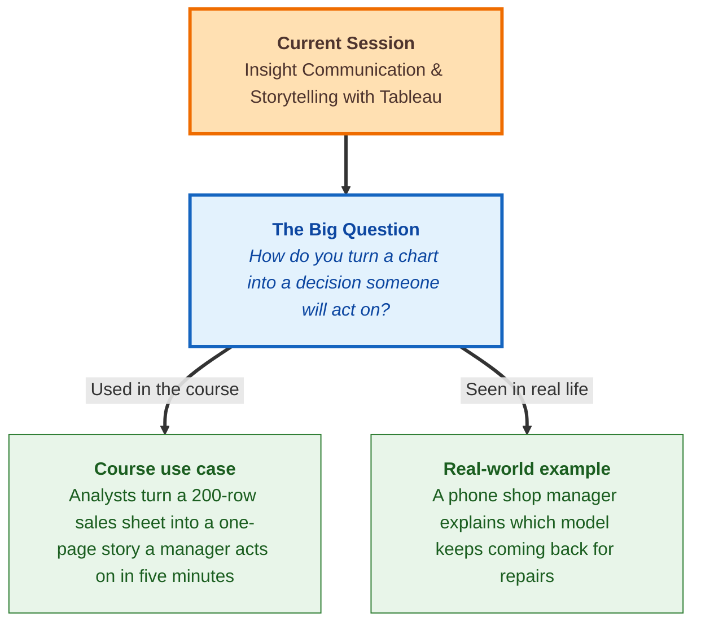

## Insight Communication & Storytelling with Tableau

### Mental Map

---

### What You'll Learn

Have you ever wondered why some charts get acted on and others get ignored?

By the end of this session, you will be able to:

- **Identify** the decision your reader is about to make.
- **Explain** what each of the four story parts does for the reader.
- **Interpret** which chart carries a message fastest.
- **Apply** the four-part order to one finding in Tableau.
- **Check** that a written note names an owner and a date.
- **Design** a one-screen story a manager can follow alone.

> **Topics you will meet:** audience-first framing, chart choice by message, headline–context–insight–recommendation, Story Points and annotations, and written handover notes.
>
> Join the session to learn each of these in detail.

---

### Why You Are Learning This Topic

You run a small phone shop. Last month, 40 phones came back for repairs.

You know the number. Your area manager does not.

If you send a chart alone, she will ask "so what?" If you send four lines with a clear next step, she will answer in ten minutes.

A **story** means four parts — headline, context, insight, recommendation — in that order.

In your course, you will use the same four parts on every dashboard you build.

> **Think about it:** Why does one chart get a reply and another get silence?

---

### The Phone Shop Puzzle

These are last month's sales and returns from one shop.

| Model | Units sold | Units returned |
|:-----:|:----------:|:--------------:|
| Nova X | 120 | 6 |
| Orbit 5 | 80 | 32 |
| Pulse 3 | 60 | 4 |
| Edge 9 | 40 | 2 |
| Mini 7 | 50 | 3 |

**What you want to happen:**

- Show which model is returned far more than the others.
- Make the gap visible in two seconds, not two minutes.
- Give the area manager one clear next step with a name and date.

> **Wonder about this:**
>
> - Why does a table of five rows hide the problem better than a sorted chart?
> - What would the area manager do first if you only sent the numbers?

---

### Think It Through

There is no wrong first try. Keep your guesses for the session.

**1. Which model would you lead with in your first sentence?**
Hint: Compare returns against units sold, not returns alone.

**2. What does the area manager need to decide after reading your note?**
Hint: Think about what she can actually change this month.

**3. What would you put in the last line of your note?**
Hint: A decision needs someone to own it and a date to check it.

---

### One Question to Carry Into the Session

> **How do you turn one chart into a decision someone will act on?**
>
> And how can you check your story reads clearly without you in the room?
