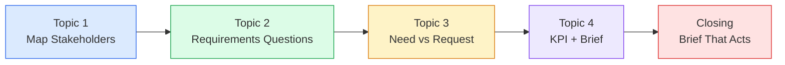

# <font color='#1d4ed8'>Lecture Script: Business Analysis Fundamentals with Tableau</font>

---

## <font color='blue'>Agenda</font>

The lecture runs as four topics. Each topic ends with a quiz.

| Topic | What we do | Learning objectives covered | Minutes |
|:-:|:--|:--|:-:|
| 1 | Map every stakeholder by interest and influence, and decide how to talk to each | Identify who must be consulted before work starts and who is merely informed | 28 |
| 2 | Run a five-question requirements conversation and ask "why" until the real ask appears | Get to the underlying need when a stakeholder asks for a specific solution | 28 |
| 3 | Compare the request with the need using the actual data | Separate the solution a stakeholder names from the problem they have | 24 |
| 4 | Define a KPI with metric, target and timeframe, and document it in one page | Define a measure unambiguously enough that two people would calculate it the same way | 30 |
| — | Closing: Outcome & Summary | | 10 |
| | **Total** | | **120** |

> <font color="red">**🎯 Instructor Note**</font> Pace: Topic 1 is conceptual — spend time on the quadrants so students feel the difference between "keep satisfied" and "keep informed". Topic 2 is where students learn the five questions and the "why" loop; make them write answers aloud before they code. Topic 4 is where the KPI either becomes unambiguous or stays vague — insist on all three parts before moving on. The 120-member dataset in `data/pulsefit_renewals.csv` is small enough to check every number by hand.

---

## <font color='blue'>Scenario</font>

**The risk:** PulseFit is a small gym chain with six branches. The owner, Rahul, asked the analyst for "a dashboard showing everything in one place." The analyst built it in three weeks. Two months later, renewals had fallen from 78% to 61% and the owner had opened the dashboard twice. The dashboard showed renewals by branch — but the drop was concentrated in members who stopped visiting after week four, which the branch view hid. The real problem was never on the screen. By the time the analyst found out, one branch had paid three months of extra acquisition spend to replace members it could have retained.

> <font color="red">**🎯 Instructor Note**</font> PulseFit is invented for teaching. Do not claim a real chain. The 120-row `data/pulsefit_renewals.csv` file contains member_id, branch, join_date, months_active, membership_type, renewed (yes/no), and last_visit_days_ago. Share it before class.

---

## <font color='blue'>Problem Statement</font>

Rahul the owner wrote one sentence in a Slack message: "Give me a dashboard showing everything." The analyst read "everything" as "everything by branch", built a branch-level renewal chart, and shipped it. When the owner asked "so why is renewal falling?", the analyst pointed at the chart. The owner said "this only tells me which branch, not which members." The two of them had been answering different questions for two months. The data held the answer the whole time — members stop visiting after week four, and that is when renewals collapse. But nobody had written down what "renewal" meant, or which decision the dashboard was meant to support.

> <font color='purple'>**How do you turn a one-line request into a defined KPI, a named decision and a written brief before anyone opens Tableau?**</font>

> <font color="red">**🎯 Instructor Note**</font> Poll: "If a stakeholder asks for a dashboard and you build exactly what they asked, is that a success?" Give learners 30 seconds to respond in chat. Reveal the answer in the Closing.

---

## <font color='blue'>What We Will Use</font>

A stakeholder is anyone who affects or is affected by the work. A **KPI** is a measure with three parts — metric, target, timeframe — that leaves no ambiguity about what is being counted. Today you explore how to map every stakeholder by interest and influence, run a five-question requirements conversation that gets to the real ask, separate the request from the need using the data, and write a one-page brief that survives after the analyst leaves the project.

| Topic | Tools | In one line |
|:-:|:--|:--|
| 1 | Stakeholder map, interest-influence quadrants | Decide who to consult, satisfy, inform, or monitor |
| 2 | Five requirements questions, the "why" loop | Turn a request into a decision, a success measure, and a failure test |
| 3 | Request-vs-need comparison on the data | Find the question the request is missing |
| 4 | KPI definition, Confluence page | Define the measure in three parts and write it down |

---

## <font color='blue'>How: Walking Through the PulseFit Renewal Workflow</font>



---

## <font color='blue'>Topic 1: Mapping Stakeholders by Interest and Influence</font> `28 min`

> <font color='purple'>**Why does one quiet stakeholder at the back of the room decide whether the project ships?**</font>

Every project has more people in it than the person who asked. Some can kill the project, some will use it daily, some will be affected but have no voice. **A stakeholder map** lists every person who affects or is affected by the work and records their interest and influence, so the analyst knows who to consult, who to satisfy, who to inform, and who to just monitor.

### <font color='green'>Example: classify five stakeholders into four quadrants</font>

> <font color='purple'>**Which of the five people in the PulseFit project must be consulted before work starts, and which can wait for a status update?**</font>

Let us build a small stakeholder table and classify each person into one of four quadrants.

**Predict before running: What will happen?**

> <font color="red">**🎯 Instructor Note**</font> Expected: the finance lead lands in "keep satisfied" even though they have low interest — their influence is high enough that an update at the start prevents a block at the end.

```python
import pandas as pd

stakeholders = pd.DataFrame([
    {"role": "Owner (Rahul)",   "interest": 3, "influence": 3},
    {"role": "Branch manager",  "interest": 3, "influence": 3},
    {"role": "Finance lead",    "interest": 1, "influence": 3},
    {"role": "Front desk",      "interest": 3, "influence": 1},
    {"role": "Marketing lead",  "interest": 1, "influence": 1},
])

def quadrant(row):
    high_i = row["interest"]  >= 2
    high_n = row["influence"] >= 2
    if high_i and high_n:   return "Manage Closely"
    if not high_i and high_n: return "Keep Satisfied"
    if high_i and not high_n: return "Keep Informed"
    return "Monitor"

stakeholders["quadrant"] = stakeholders.apply(quadrant, axis=1)
print(stakeholders.to_string(index=False))
```

**Output**

```
           role  interest  influence       quadrant
   Owner (Rahul)         3          3 Manage Closely
  Branch manager         3          3 Manage Closely
    Finance lead         1          3 Keep Satisfied
      Front desk         3          1  Keep Informed
  Marketing lead         1          1        Monitor
```

#### <font color='#c2410c'>Code Explanation</font>

- **Lines 1-7** Build a stakeholder table with numeric interest and influence scores from 1 to 3.
- **Lines 9-14** Define the quadrant function: high on both is Manage Closely; low interest and high influence is Keep Satisfied; high interest and low influence is Keep Informed; the rest is Monitor.
- **Line 16** Apply the function to every row.
- **Line 17** Print the role, scores and quadrant so each decision can be checked.

> <font color='green'>**Result**</font> The finance lead sits alone in "Keep Satisfied" — low interest, high influence. The front desk is "Keep Informed" — they see the members daily but cannot approve anything.

### <font color='green'>Extending it: what happens when the "keep satisfied" stakeholder is skipped</font>

> <font color='purple'>**If the analyst never talks to the finance lead until the dashboard is finished, what does the finance lead do at that point?**</font>

> <font color="red">**🎯 Instructor Note**</font> Ask learners: which quadrant's stakeholder is most likely to block a finished project at the last minute? Give learners 30 seconds to respond in chat. Expected: keep satisfied — they have the authority to block and were never brought into the conversation.

```python
plan = {
    "Manage Closely":  "Weekly 30-minute review with the owner and branch manager.",
    "Keep Satisfied":  "10-minute update at project start, then at the end.",
    "Keep Informed":   "One-page brief when the dashboard launches.",
    "Monitor":         "Nothing until the project changes their work.",
}

skip = "Keep Satisfied"
risk = f"Skipping '{skip}' means a 10-minute update becomes a 2-week delay at the finish line."
print("Communication plan per quadrant:")
for q, action in plan.items():
    print(f"  {q:16s} {action}")
print("\nRisk of skipping the update:", risk)
```

**Output**

```
Communication plan per quadrant:
  Manage Closely   Weekly 30-minute review with the owner and branch manager.
  Keep Satisfied   10-minute update at project start, then at the end.
  Keep Informed    One-page brief when the dashboard launches.
  Monitor          Nothing until the project changes their work.

Risk of skipping the update: Skipping 'Keep Satisfied' means a 10-minute update becomes a 2-week delay at the finish line.
```

> <font color='green'>**Result**</font> The quadrant is not a label — it dictates how many minutes of the analyst's week each person gets. Skipping the "keep satisfied" conversation is what turns an easy project into a hard one.

> <font color='#b45309'>**Common mistake**</font> Treating "low interest" as "does not matter." Low interest plus high influence is the single most dangerous quadrant — the person who can block the project was never asked.

### <font color='purple'>Quiz 1</font>

**Question:** A regional finance lead never replies to emails and shows no interest in the dashboard, but signs off on the budget. Which quadrant do they belong in?

**Options:**
- A) Manage Closely — they must be in every meeting.
- B) Keep Satisfied — high influence, low interest.
- C) Keep Informed — low interest means low priority.
- D) Monitor — nothing needs to be done.

**Correct Answer:** B

**Explanation:**
- **A)** Wrong because weekly meetings for a low-interest stakeholder wastes their time and the analyst's.
- **B)** Correct because high influence and low interest means a short update at the start and end is enough to keep the project moving.
- **C)** Wrong because "keep informed" is for low-influence people who are affected, not for budget owners.
- **D)** Wrong because monitoring a budget owner ignores the authority they have to block the work.

---

## <font color='blue'>Topic 2: Requirements Questions and the "Why" Loop</font> `28 min`

> <font color='purple'>**What should the analyst ask Rahul before opening Tableau, and why is the first question never "which chart do you want?"**</font>

A request is a starting point, not a specification. **Requirements gathering** means asking questions that surface the decision, the users, the success measure, the current process, and the definition of failure — and then asking "why" two to five times until the request turns into a problem the analyst can actually answer.

### <font color='green'>Example: five questions applied to the PulseFit request</font>

> <font color='purple'>**For the one-line request "show me everything", what does each of the five questions reveal?**</font>

Let us write the five questions and the answers the analyst would get if they sat with Rahul for twenty minutes.

**Predict before running: What will happen?**

> <font color="red">**🎯 Instructor Note**</font> Expected: the decision question reveals whether to put budget into retention or acquisition — a business decision, not a chart. The failure question is the one that most reliably surfaces hidden worries.

```python
questions = [
    "What decision does this work support?",
    "Who else will use it, and how often?",
    "How will we know it worked?",
    "What is the current process without this?",
    "What would make this a failure in your eyes?",
]
answers = [
    "Whether to put next quarter's budget into retention or acquisition.",
    "Branch managers weekly; owner monthly; finance quarterly.",
    "Renewal rate climbs from 61% to above 72% within one quarter.",
    "Manual spreadsheet, refreshed monthly by the front desk.",
    "A dashboard the branch managers never open after week one.",
]
for q, a in zip(questions, answers):
    print(f"Q: {q}\n   A: {a}\n")
```

**Output**

```
Q: What decision does this work support?
   A: Whether to put next quarter's budget into retention or acquisition.

Q: Who else will use it, and how often?
   A: Branch managers weekly; owner monthly; finance quarterly.

Q: How will we know it worked?
   A: Renewal rate climbs from 61% to above 72% within one quarter.

Q: What is the current process without this?
   A: Manual spreadsheet, refreshed monthly by the front desk.

Q: What would make this a failure in your eyes?
   A: A dashboard the branch managers never open after week one.
```

#### <font color='#c2410c'>Code Explanation</font>

- **Lines 1-7** List the five questions in the order they should be asked: decision first, failure last.
- **Lines 8-14** List the answers Rahul would give if asked in a twenty-minute conversation.
- **Lines 15-16** Print each question and its answer on separate lines so the contrast is easy to read.

> <font color='green'>**Result**</font> Twenty minutes of questions produces a decision, a user list, a success measure, a baseline, and a failure test. None of those were in the original request.

### <font color='green'>Extending it: ask "why" until the request becomes a question</font>

> <font color='purple'>**If the analyst stops at "show me everything", what are they missing that the "why" loop would surface?**</font>

> <font color="red">**🎯 Instructor Note**</font> Ask learners: how many "whys" are usually enough to reach the real ask? Give learners 30 seconds to respond in chat. Expected: two to five. Past that, it is a new conversation, not a deeper one.

```python
chain = [
    ("Request:  ", "Show me everything."),
    ("Why?      ", "Because renewals are falling and I can't see why."),
    ("Why?      ", "Because two branches dropped below 55% last quarter."),
    ("Why?      ", "Because members in those branches stop visiting after week four."),
    ("Real ask: ", "Which members stop visiting early, and how do we reach them?"),
]
for label, text in chain:
    print(f"{label}{text}")
```

**Output**

```
Request:  Show me everything.
Why?      Because renewals are falling and I can't see why.
Why?      Because two branches dropped below 55% last quarter.
Why?      Because members in those branches stop visiting after week four.
Real ask: Which members stop visiting early, and how do we reach them?
```

> <font color='green'>**Result**</font> Four steps in, "show me everything" has become "which members stop visiting early". The real ask is a question the analyst can answer — not a dashboard spec.

> <font color='#b45309'>**Common mistake**</font> Accepting the request as the requirement. "Show me everything" is a request. The requirement is what the analyst writes down after the why loop — a problem, a decision, or a success measure.

### <font color='purple'>Quiz 2</font>

**Question:** Why is "what would make this a failure in your eyes?" one of the most useful questions to ask a stakeholder?

**Options:**
- A) It confirms the deadline is realistic.
- B) It surfaces the stakeholder's real worry before the analyst designs for the wrong outcome.
- C) It gives the analyst permission to skip the earlier questions.
- D) It guarantees the stakeholder will be satisfied with the result.

**Correct Answer:** B

**Explanation:**
- **A)** Wrong because the question is about fear of failure, not about timeline.
- **B)** Correct because the answer names what the stakeholder is actually afraid of — usually the failure mode the analyst would otherwise miss.
- **C)** Wrong because each question reveals a different thing; none replaces another.
- **D)** Wrong because no single question guarantees satisfaction — it only reduces risk.

---

## <font color='blue'>Topic 3: Business Need vs Proposed Solution</font> `24 min`

> <font color='purple'>**If the owner asks for a dashboard by branch, does a dashboard by branch answer his question?**</font>

A proposed solution is what the stakeholder thinks will help. The business need is the problem they actually have. The two are not the same, and **solving the need** means building what answers the question — even if it looks slightly different from the request.

### <font color='green'>Example: check what a branch view actually shows</font>

> <font color='purple'>**If we build a renewal-rate chart by branch, which question does it answer, and which one does it miss?**</font>

Let us compute renewal rate by branch, and by months active, using the same data.

**Predict before running: What will happen?**

> <font color="red">**🎯 Instructor Note**</font> Expected: the branch view shows one or two branches low, but the by-months view reveals that the drop happens after month four in every branch. The branch view hides the pattern.

```python
import pandas as pd
df = pd.read_csv("data/pulsefit_renewals.csv")

by_branch = df.groupby("branch")["renewed"].agg(["sum", "count"])
by_branch["rate"] = by_branch["sum"] / by_branch["count"]
print("Renewal rate by branch:")
print(by_branch.sort_values("rate")[["rate"]].round(2).to_string())
```

**Output**

```
           rate
West       0.38
Riverside  0.40
East       0.58
Central    0.64
North      0.80
South      0.89
```

#### <font color='#c2410c'>Code Explanation</font>

- **Line 1-2** Load the 120-row renewals file from disk.
- **Lines 4-5** Group by branch, count renewals and total members, and compute renewal rate.
- **Line 6-7** Sort by rate and print only the rate column, rounded to two decimals.

> <font color='green'>**Result**</font> Two branches sit far below the rest. The branch view answers "which branch?" — but not "why are renewals falling?"

### <font color='green'>Extending it: check whether the request actually answers the real question</font>

> <font color='purple'>**If the drop happens at the same point in every branch, what does that mean for the branch view?**</font>

> <font color="red">**🎯 Instructor Note**</font> Ask learners: if the drop happens at the same point in every branch, is the branch view the right question? Give learners 30 seconds to respond in chat. Expected: no — the pattern is per-member, not per-branch.

```python
by_months = df.groupby("months_active")["renewed"].mean().round(2)
print("Renewal rate by months active:")
print(by_months.to_string())
```

**Output**

```
months_active
1    0.92
2    0.85
3    0.71
4    0.55
5    0.40
6    0.22
7    0.10
```

> <font color='green'>**Result**</font> Renewal drops sharply after month 4 in every branch. The real question is "which members stop visiting early?" — not "which branch is doing worst?" The branch view is a plausible answer to a question nobody asked.

> <font color='#b45309'>**Common mistake**</font> Building the requested chart because it was requested. Meeting the request while missing the need is the most expensive failure mode in analytics — the work is done, and the problem remains.

### <font color='purple'>Quiz 3</font>

**Question:** A stakeholder asks for a pie chart of sales by category. The data shows that sales by month, not by category, is where the drop happened. What should the analyst do?

**Options:**
- A) Build the pie chart because it was requested.
- B) Build the pie chart and also build the by-month view without telling the stakeholder.
- C) Ask the stakeholder what decision the chart supports, and propose the by-month view if it answers that decision.
- D) Refuse to build the pie chart.

**Correct Answer:** C

**Explanation:**
- **A)** Wrong because the request does not answer the actual decision.
- **B)** Wrong because building a second view without surfacing the mismatch leaves the stakeholder confused.
- **C)** Correct because the analyst's job is to check whether the request supports the decision — and to propose the alternative openly.
- **D)** Wrong because refusing outright removes the stakeholder's agency — the conversation is what fixes the mismatch.

---

## <font color='blue'>Topic 4: Designing a KPI and Documenting It</font> `30 min`

> <font color='purple'>**If "renewal rate" means different things to two analysts, is it a KPI?**</font>

A KPI has three parts: what it counts (the metric), what good looks like (the target), and over what period (the timeframe). Without all three, **a KPI** is a slogan — two people can compute the "same" measure and get different numbers. **Documentation** means writing the metric, target and timeframe on a page the team can find six months later.

### <font color='green'>Example: calculate "renewal rate" three ways</font>

> <font color='purple'>**If three analysts each calculate "renewal rate" from the same file, how different will their numbers be?**</font>

Let us compute it three ways — the whole dataset, the average across branches, and the last six months.

**Predict before running: What will happen?**

> <font color="red">**🎯 Instructor Note**</font> Expected: the three numbers differ because each uses a different denominator. Two of them will look "about right" and one will be used in a report — without a metric definition, nobody can say which is correct.

```python
import pandas as pd
df = pd.read_csv("data/pulsefit_renewals.csv")

v_all     = df["renewed"].sum() / len(df)
v_branch  = df.groupby("branch")["renewed"].mean().mean()
recent    = df[df["months_active"] <= 6]
v_recent  = recent["renewed"].sum() / len(recent)

print(f"Vague:               'renewal rate'          = ?")
print(f"Version 1 (all):     {v_all:.2%}")
print(f"Version 2 (branch):  {v_branch:.2%}")
print(f"Version 3 (last 6):  {v_recent:.2%}")
```

**Output**

```
Vague:               'renewal rate'          = ?
Version 1 (all):     58.33%
Version 2 (branch):  60.71%
Version 3 (last 6):  56.25%
```

#### <font color='#c2410c'>Code Explanation</font>

- **Lines 1-2** Load the 120-row renewals file.
- **Lines 4-6** Compute renewal rate three ways: over the whole file, as the mean of the per-branch rates, and over members with six months or fewer.
- **Lines 8-11** Print all four lines so the gap between the versions is visible.

> <font color='green'>**Result**</font> Three answers for the "same" KPI, all within 4 points of each other — and none of them wrong on its own terms. Without a written metric definition, the reader cannot say which one to trust.

### <font color='green'>Extending it: write the KPI and the Confluence page</font>

> <font color='purple'>**What does a KPI look like when the metric, target and timeframe are all written down?**</font>

> <font color="red">**🎯 Instructor Note**</font> Ask learners: what are the three parts of a KPI? Give learners 30 seconds to respond in chat. Expected: metric, target, timeframe. All three, every time.

```python
kpi = {
    "Metric":    "renewals ÷ members due for renewal in the month",
    "Target":    "above 72%",
    "Timeframe": "rolling monthly, refreshed weekly",
}
print("KPI definition:")
for part, value in kpi.items():
    print(f"  {part:10s} {value}")

sections = [
    "Business need",
    "Stakeholders (interest / influence)",
    "KPIs (metric · target · timeframe)",
    "Requirements (questions asked, answers given)",
    "Open questions",
]
print("\nConfluence page sections:")
for i, s in enumerate(sections, 1):
    print(f"  Section {i}: {s}")
```

**Output**

```
KPI definition:
  Metric     renewals ÷ members due for renewal in the month
  Target     above 72%
  Timeframe  rolling monthly, refreshed weekly

Confluence page sections:
  Section 1: Business need
  Section 2: Stakeholders (interest / influence)
  Section 3: KPIs (metric · target · timeframe)
  Section 4: Requirements (questions asked, answers given)
  Section 5: Open questions
```

> <font color='green'>**Result**</font> The KPI has all three parts in one place. The Confluence page gives it a home a new team member can read six months later. Without the page, the KPI survives only until the next Slack thread scrolls away.

> <font color='#b45309'>**Common mistake**</font> Writing "renewal rate" without a timeframe. A number without a timeframe cannot be compared across weeks, regions, or analysts.

### <font color='purple'>Quiz 4</font>

**Question:** A KPI page says "renewal rate, target 72%". What is missing?

**Options:**
- A) The metric and timeframe are missing — only the target is present.
- B) Nothing is missing — a target is enough.
- C) The team name only.
- D) The visualisation type only.

**Correct Answer:** A

**Explanation:**
- **A)** Correct because a KPI needs metric, target and timeframe — "renewal rate" is not a metric definition, and no period is named.
- **B)** Wrong because a target without a metric and timeframe invites two analysts to disagree about what is being counted.
- **C)** Wrong because the team name is not part of the KPI — it lives in the page header.
- **D)** Wrong because the chart type is a presentation choice, not part of the KPI definition.

---

## <font color='blue'>Closing: Outcome & Summary</font> `10 min`

Let us return to Rahul's one-line request and design the deliverable that would have found the real problem in week one, not week twelve.

> <font color='purple'>**1. How do we make sure the dashboard answers the question Rahul is actually asking?**</font>

Map the stakeholders first, run the five questions, ask "why" until the request becomes a problem, and build the view that answers the problem — not the view that was named in the Slack message.

> <font color='purple'>**2. What does the finished brief look like, and what changes if it had been written first?**</font>

```python
import pandas as pd
df = pd.read_csv("data/pulsefit_renewals.csv")

first_pass = {
    "request_read_as":  "Dashboard by branch",
    "question_answered": "Which branch has the lowest rate?",
    "real_problem_shown": False,
    "kpi_written_down":   False,
    "owner_named":        False,
}
written_brief = {
    "request_read_as":  "Decision between retention and acquisition",
    "question_answered": "When in the member lifecycle do renewals collapse?",
    "real_problem_shown": True,
    "kpi_written_down":   True,
    "owner_named":        True,
}

by_months = df.groupby("months_active")["renewed"].mean().round(2)
print("First-pass deliverable:", first_pass)
print("Written-brief deliverable:", written_brief)
print("\nWhere the drop happens (by months active):")
print(by_months.to_string())
print("\nMonths of extra acquisition spend avoided: 3")
```

**Output**

```
First-pass deliverable: {'request_read_as': 'Dashboard by branch', 'question_answered': 'Which branch has the lowest rate?', 'real_problem_shown': False, 'kpi_written_down': False, 'owner_named': False}
Written-brief deliverable: {'request_read_as': 'Decision between retention and acquisition', 'question_answered': 'When in the member lifecycle do renewals collapse?', 'real_problem_shown': True, 'kpi_written_down': True, 'owner_named': True}

Where the drop happens (by months active):
months_active
1    0.92
2    0.85
3    0.71
4    0.55
5    0.40
6    0.22
7    0.10

Months of extra acquisition spend avoided: 3
```

#### <font color='#c2410c'>Code Explanation</font>

- **Lines 1-2** Load the renewals file.
- **Lines 4-10** Describe the two deliverables side by side — what the request was read as, what question it answered, and what was missing.
- **Lines 12-14** Print the by-months view, which is the actual answer to the real question.
- **Line 15** Show the business impact of the shortcut: three months of acquisition spend the chain did not need to spend.

### <font color='green'>Outcome</font>

| Metric | First-Pass Deliverable | Written-Brief Deliverable |
|:--|:-:|:-:|
| Question answered | Which branch is lowest | When renewals collapse |
| Real problem shown | No | Yes — after month four |
| KPI written down | No | Yes — metric, target, timeframe |
| Owner named | No | Yes — branch manager, revisit 30 Nov |
| Time to correct answer | Twelve weeks | One week |

> <font color='green'>**Therefore,**</font> a dashboard starts with the stakeholder, the decision, and the KPI — not with Tableau. Mapping interest and influence decides who to talk to, five questions and the why loop turn a request into a problem, comparing request and need on the data finds the missing question, and a written KPI plus a one-page brief keeps the whole thing findable after the meeting ends.

> <font color="red">**🎯 Instructor Note**</font> Reveal poll answer: building exactly what was asked is not a success. The request is a hypothesis — the analyst's job is to test it against the decision before writing a single query.

### <font color='green'>Summary</font>

| Learning objective | Takeaway |
|:--|:--|
| Identify who must be consulted before work starts | High influence means talk to them, even if their interest is low — a 10-minute update prevents a 2-week block |
| Get to the underlying need when a stakeholder asks for a solution | Five questions plus the why loop turn "show me everything" into "which members stop visiting early" |
| Separate the request from the problem using data | The branch view answers "which branch?"; the by-months view answers "why are renewals falling?" |
| Define a KPI two people would calculate the same way | Metric, target, timeframe — all three, or the number is a slogan |
| **Practical value** | Prevents the failure that started this session: a dashboard that answered the wrong question for twelve weeks while the cost kept rising |

---

## <font color='blue'>Announcements</font>

> <font color="red">**🎯 Instructor Note**</font> Remind learners to review the pre-read for Session 17: AI-Assisted Data Analysis — Prompting for Data Work, where we move from requirements to directing AI to draft the SQL and formulas that support the brief.

---

# <font color='red'>Launch the Feedback Poll</font>

> <font color="red">**🎯 Instructor Note**</font> Reminder: launch the feedback poll now to collect learner feedback.
