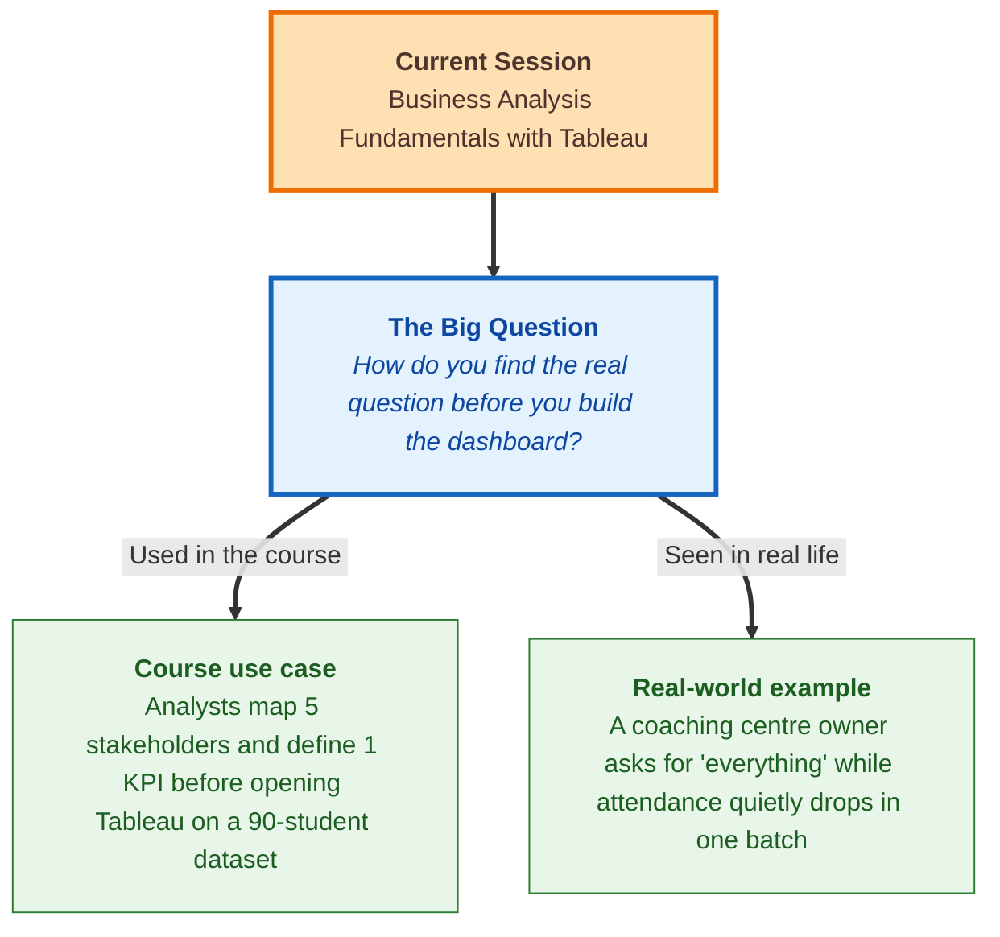

## Business Analysis Fundamentals with Tableau

### Mental Map

---

### What You'll Learn

Have you ever wondered why a manager asks for "everything" and still feels nothing was answered?

By the end of this session, you will be able to:

- **Identify** every person who affects or is affected by a project.
- **Explain** why a quiet stakeholder can block a finished project.
- **Apply** five questions to turn a request into a clear problem.
- **Compare** the request a stakeholder makes with the need behind it.
- **Check** that two analysts would calculate one measure the same way.
- **Design** a one-page brief another person can pick up and use.

> **Topics you will meet:** stakeholder mapping, interest and influence quadrants, requirements questions, business need versus proposed solution, KPI design, and one-page documentation.
>
> Join the session to learn each of these in detail.

---

### Why You Are Learning This Topic

The owner of a small coaching centre asks for a dashboard with everything in one place. You build it. Two months later, attendance keeps dropping.

He never opens the dashboard. The reason is simple — it answered a question he never asked.

A **KPI** means one measure with three parts: what it counts, what good looks like, and over what period.

In your course, you will use the same three parts to make sure your dashboards answer the real question.

> **Think about it:** Why does a dashboard answering the wrong question still look correct?

---

### The Coaching Centre Puzzle

Last month, 90 students were enrolled across five batches.

| Batch | Enrolled | Attending regularly |
|:-----:|:--------:|:-------------------:|
| Morning A | 20 | 16 |
| Morning B | 18 | 10 |
| Evening A | 22 | 19 |
| Evening B | 15 | 7 |
| Weekend | 15 | 12 |

**What you want to happen:**

- See which batch has the lowest attendance.
- Know which two people must agree before you build anything.
- Have the dashboard read the same way to every teacher.

> **Wonder about this:**
>
> - Why does the owner say "everything" when he might mean one thing?
> - What would make two teachers read the same number differently?

---

### Think It Through

There is no wrong first try. Keep your guesses for the session.

**1. Which batch needs the most attention?**
Hint: A small batch with few attendees may still have a low rate.

**2. Who else besides the owner might care about these numbers?**
Hint: Think about who sees the students every day.

**3. If two people calculated "attendance rate" differently, what would that look like?**
Hint: One might count students, another might count sessions.

---

### One Question to Carry Into the Session

> **How do you find the real question before you build the dashboard?**
>
> And how can you check two people would answer it the same way?
